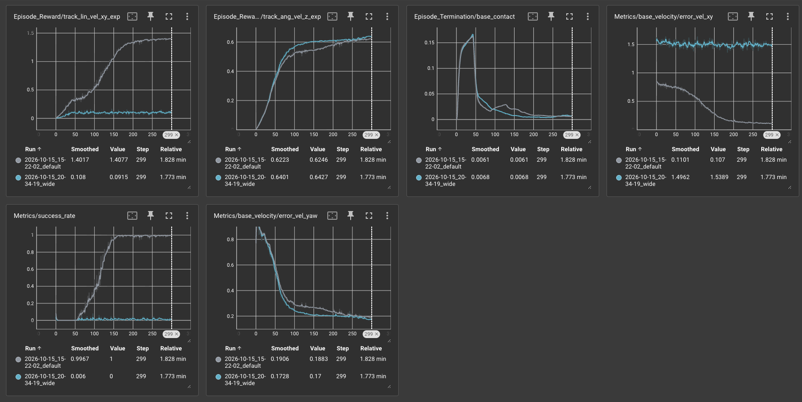
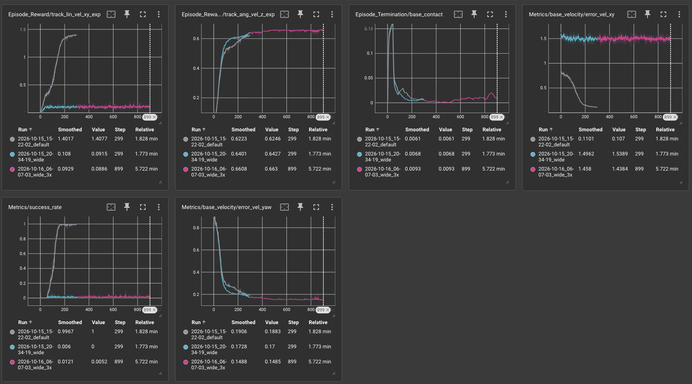

## Setup
The range is set in `CommandsCfg` in `isaaclab_tasks/manager_based/locomotion/velocity/velocity_env_cfg.py` (line 149).

## Prediction, before training the wide-range policy (Oct 16, 1:31am)
I widened `lin_vel_x` and `lin_vel_y`, which are forward/backward and sideways inputs, respectively, from (-1, 1) to (-2, 2) m/s. `ang_vel_z` is left unchanged. 

**Physical feasibility:** According to Unitree's specs ([unitree.com/go2](https://www.unitree.com/go2/)), the Go2's top forward speed is 2.5-3.7 m/s depending on the model, so +-2 m/s forward is physically plausible. However, I could not verify if the sideways speed can reach +-2 m/s as well. Although possible, I expect the robot to undershoot fast `lin_vel_y` commands because moving sideways for a quadruped relies on hip joints with a smaller range of motion.

**What I expect:**
1. `error_vel_xy` will increase.
2. `success_rate` will decrease.
3. `base_contact` will remain around the same.

**Why:**
The policy's reward weights and tracking tolerance were chosen for the default +-1 range. Given that the tracking reward is `exp(-error^2 / 0.25)`, when the robot is far from a fast command, the reward is almost 0, meaning that the policy receives almost no feedback about how to go faster. At the same time, the penalties give a clear feedback regardless, which I expect to result in the policy preferring balance over speed (hence, I expect the `base_contact` to remain around the default's value). I expect the `success_rate` to drop because the threshold (0.5 m/s) stays fixed while the range of commands becomes twice as large -> stricter tolerance

I expect the 3x iteration time to help improve the `error_vel_xy` and `success_rate` for wider-range policy, but I'm skeptical about it performing the same or better than the default unless the physical-plausibility of the sideways motion of (-2, 2) is proven and the reward weights and tracking tolerance are adjusted.

## Results (wide-range vs default)

| Metric (iteration 299) | Default (±1 m/s) | Wide (±2 m/s) |
|---|---|---|
| `error_vel_xy` (m/s) | 0.107 | 1.539 |
| `success_rate` | 1.0 | 0.0 |
| `base_contact` | 0.0061 | 0.0068 |
| `error_vel_yaw` (rad/s) | 0.188 | 0.170 |
| `track_lin_vel_xy_exp` reward | 1.408 | 0.092 |
| `track_ang_vel_z_exp` reward | 0.625 | 0.643 |

Values are the raw (unsmoothed) values at the final iteration.

## Comparison against my predictions
As expected, `error_vel_xy` increased, `success_rate` decreased, and `base_contact` remained about the same as default.

However, I expected the policy to undershoot fast commands, but what actually ended up happening is that the policy did not learn to move at all (the video shows robots not moving even for slow commands, which the default policy tracked well). This is shown by `success_rate` staying at 0 for all iterations, and by the `error_vel_xy` curve staying flat at ~1.5 from the first to last iteration. The `track_lin_vel_xy_exp` also stayed flat at ~0.1, while the default's rose to 1.4, for the whole run, which supports my prediction that the policy receives almost no feedback about how to go faster.

Not covered in my prediction: `error_vel_yaw` and `track_ang_vel_z_exp` performed as well as the default, so the policy learned to turn.

Overall, the policy ended up preferring balance over speed, and Go2 stood and turned in place.

Also, I had attributed the undershooting to the possible physical limitations of the Go2's sideways motion, but the policy failed at slow commands as well, so I think that the weak reward signal is a better explanation for this performance.

The video confirms that the robots do not move: the blue arrows (velocity) stay near zero while the green arrows (commands) are long.

## Results (wide-range trained 3x longer)

| Metric (final iteration) | Default (±1 m/s, 300 it.) | Wide (±2 m/s, 300 it.) | Wide 3× (±2 m/s, 900 it.) |
|---|---|---|---|
| `error_vel_xy` (m/s) | 0.107 | 1.539 | 1.438 |
| `success_rate` | 1.0 | 0.0 | 0.005 |
| `base_contact` | 0.0061 | 0.0068 | 0.0093 |
| `error_vel_yaw` (rad/s) | 0.188 | 0.170 | 0.149 |
| `track_lin_vel_xy_exp` reward | 1.408 | 0.092 | 0.089 |
| `track_ang_vel_z_exp` reward | 0.625 | 0.643 | 0.663 |

## Discussion
1. Did more training time fix it?
No, `error_vel_xy` stayed flat ~1.45, `success_rate` stayed at ~0, and the `track_lin_vel_xy_exp` reward stayed at ~0.09. The policy did not learn to move, and the only improvement was turning (`error_vel_yaw`)

I expected the `success_rate` and `error_vel_xy` to improve given more time for training, even if slightly, but the raw values stayed within the noise. 

2. What this rules out
The initial failure of the wide-range policy was not caused by insufficient training time. Even at 3x more training time, the policy did not learn to move at all. Much longer training was not tested, however, so I cannot claim that it won't work at all if given even more time, but I expect it not to.

3. What it suggests
The problem comes down to the tracking reward giving almost no feedback for moving towards fast commands, so the policy ends up choosing the stable strategy of standing, crouching, and turning. Widening the tracking tolerance could help. It could also be combined with starting at the default +-1 range and widening it as the policy succeeds, so that the policy is not stuck with no movement right from the beginning (not tested).

The 3x video (`wide_3x.mp4`) looks the same as the wide one: the robots crouch, turn in place, and their velocity (blue arrows) stays near zero.

